  

<h1 align="center">Hi, I'm Shubham Padhy 👋</h1>

<h3 align="center">Full-Stack Developer | MERN Stack | Game Development</h3>

  <a href="https://www.linkedin.com/in/shubham-padhy-467749355/">
    LinkedIn
  </a>
  •
  <a href="https://github.com/shubhampadhy512">
    GitHub
  </a>

---

## 👨‍💻 About Me

- 🌐 Full-stack developer focused on the MERN stack.
- 🎮 Interested in game development with Unity and C#.
- 🔎 Exploring search engine development.
- 🗄️ Working with SQL and NoSQL databases.
- 🚀 Building projects to improve my development skills.

## 🛠️ Tech Stack

  

## 📊 GitHub Stats

  
  

## 🔥 Contribution Streak

  

---

  <i>Building, learning, and improving one project at a time.</i>

